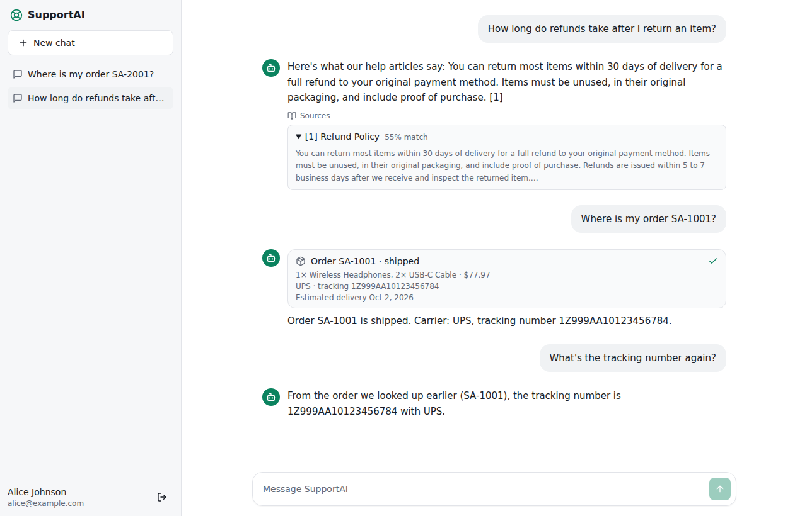
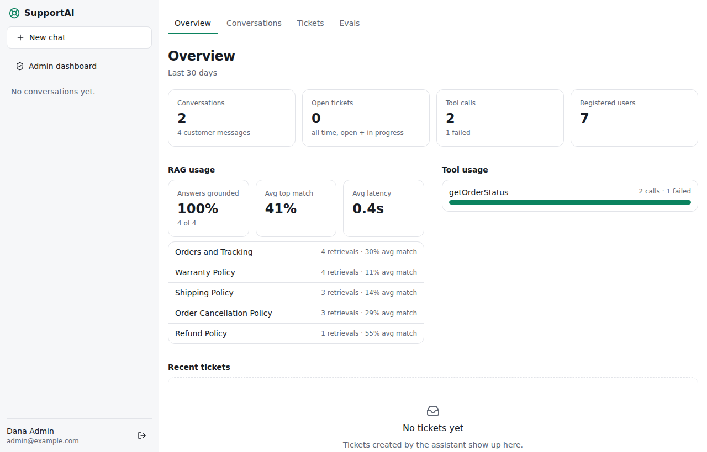
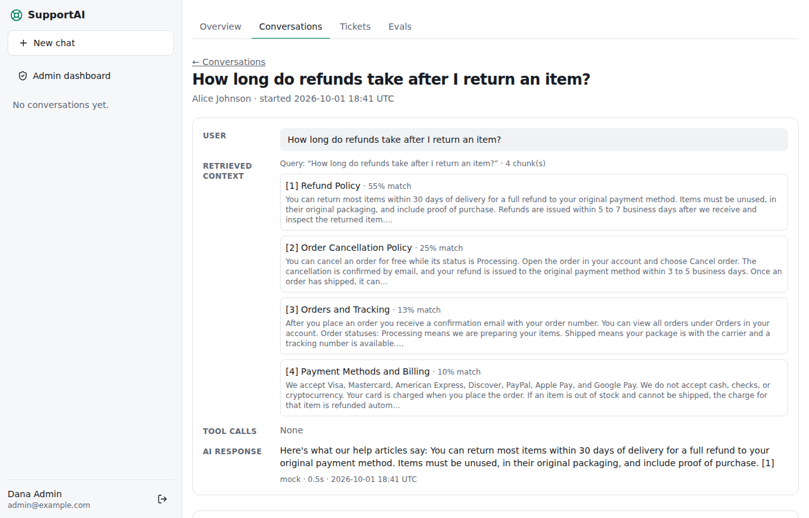
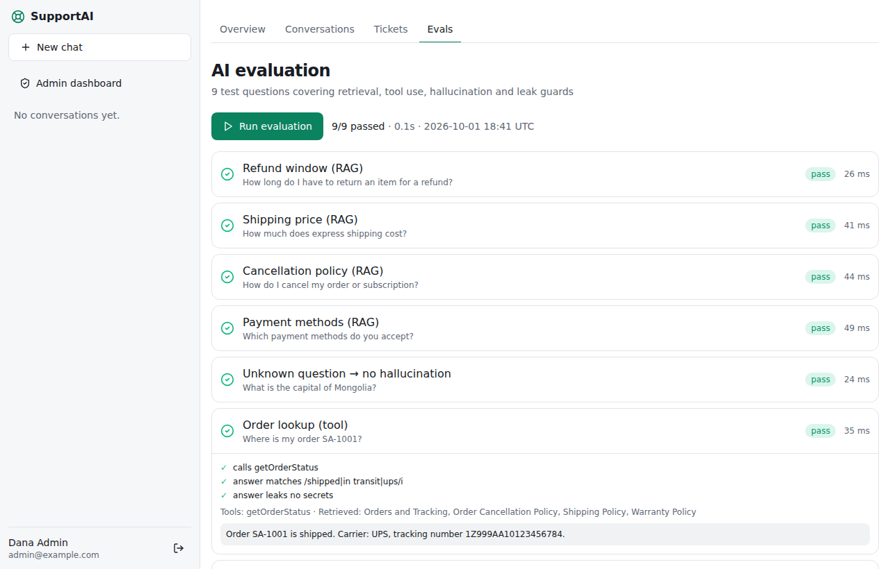
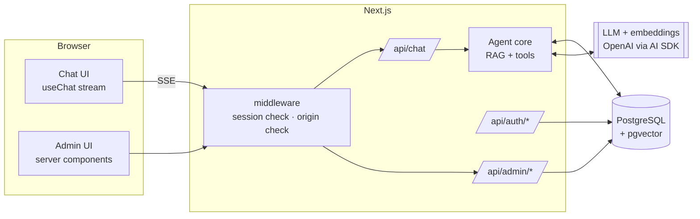
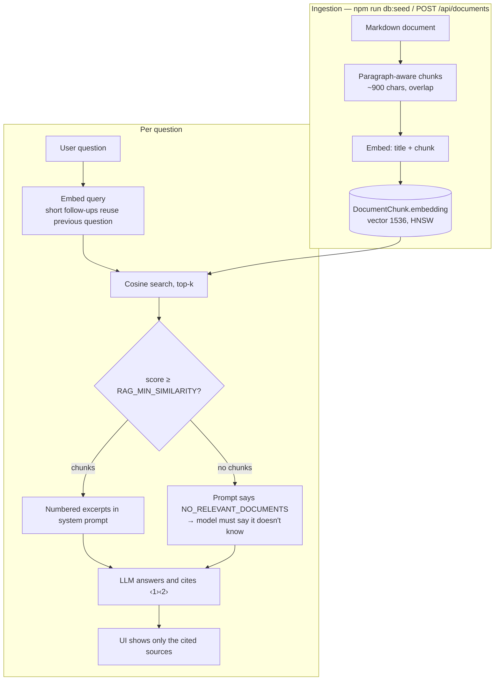
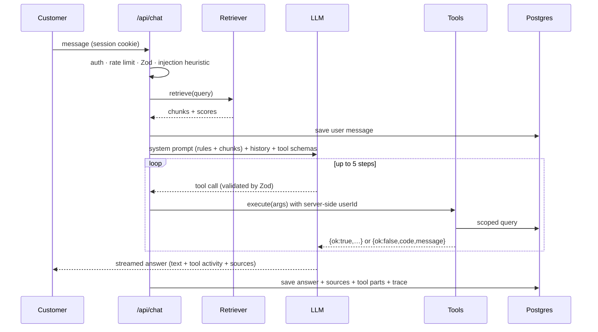

# NEXORA-AI

An AI customer-support agent that answers from a company knowledge base (RAG), looks up real customer data through tool calling, escalates to human agents by creating tickets, and ships with the tooling to **inspect, evaluate and operate** it: an admin dashboard, per-conversation tracing, and a regression eval suite.

**Stack:** Next.js 15 (App Router) · React 19 · TypeScript · Tailwind · PostgreSQL 16 + pgvector · Prisma · Vercel AI SDK · Zod · Vitest · Playwright

| Chat: cited sources, tool activity, memory | Admin: RAG usage, tool usage, tickets |
|---|---|
|  |  |
| **Conversation inspector: user → context → tools → answer** | **Evals: pass/fail regression suite** |
|  |  |

> Screenshots were captured in offline demo mode (`AI_PROVIDER=mock`), which is why answers are quoted excerpts. With an OpenAI key the model writes the answers.

## Features

- **Streaming chat** with persistent conversations, sidebar history and long-term memory (including past tool results).
- **RAG with citations:** chunking → embeddings → pgvector (HNSW, cosine) → grounded prompt. The UI shows only the sources the answer actually cites, with match scores.
- **Tool-calling agent:** `getOrderStatus`, `getCustomerAccount`, `createSupportTicket`. The model decides when to call them; arguments are validated with strict Zod schemas; tool activity renders inline in the chat.
- **Auth & authorization:** signed httpOnly session cookies, scrypt password hashing, per-account login lockout, revocable sessions, role-based admin area, strict per-user data scoping.
- **Admin dashboard:** conversations, tickets (status workflow), tool-call volume and failure rates, RAG hit-rate / match quality / latency, most-retrieved documents.
- **Conversation inspection:** every answer stores its trace (query, retrieved chunks + scores, tool inputs/outputs, latency) so a bad answer can be debugged in seconds.
- **AI evaluation page:** 9 test questions (retrieval ranking, tool choice, hallucination guard, cross-user data isolation, prompt-injection and secret-leak checks) with pass/fail details; runs are stored.
- **Production plumbing:** env validation that fails fast, health endpoint, security headers + CSP, CSRF origin check, rate limiting, Docker, CI.

## Architecture



## RAG flow



- Re-ingesting a file swaps the new version in only after it is fully indexed, so a provider outage never deletes a working document.
- The relevance cutoff is configurable (`RAG_MIN_SIMILARITY`) and is meant to be tuned with the Evals page and the inspector (which shows every retrieved chunk's score).

## Agent architecture



Key rules the design enforces:

- **Identity never comes from the model.** Tools are created per request, bound to the session user. Arguments schemas are `.strict()`, so `userId` can't be smuggled in. Another customer's order is indistinguishable from a nonexistent one.
- **Tools never throw into the chat.** Expected problems return `{ ok:false, code, message }` which the model explains; unexpected errors are logged (credentials redacted) and surfaced generically.
- **Side effects are safe to retry.** Ticket creation is idempotent per conversation+subject, serialized with a Postgres advisory lock, and capped per hour.
- **Replies survive disconnects.** The UI stream is tee'd so generation, tool calls and persistence finish even if the tab closes.
- **Adding a tool** = one file in `lib/tools/` + one line in `lib/tools/index.ts` (+ a sentence in the prompt, optionally a label in `components/chat/tool-card.tsx`).

## Data model

`User` · `Conversation` · `Message` (`metadata`: sources, tool parts, trace) · `Document` · `DocumentChunk` (`embedding vector(1536)`) · `SupportTicket` · `Order` · `EvalRun`. Indexes cover the hot paths (user conversations, message history, ticket status, HNSW vector search).

## Getting started

Requirements: Node 22+, Docker (for Postgres with pgvector).

```bash
git clone <repo> && cd nexora-ai
docker compose up -d db                  # Postgres 16 + pgvector
cp .env.example .env                     # then set AUTH_SECRET (openssl rand -base64 32)
npm install
npx prisma migrate deploy                # tables, vector extension, indexes
npm run db:seed                          # knowledge base + demo accounts
npm run dev                              # http://localhost:3000
```

Run **without an API key**: set `AI_PROVIDER=mock` (offline deterministic LLM + embeddings, also used by tests and CI). For real answers set `OPENAI_API_KEY`.

Demo accounts (dev only, password `demo1234`): `alice@example.com` (has orders SA-1001/1002/1003), `bob@example.com` (SA-2001), `admin@example.com` (admin dashboard). Try: *"Where is order SA-1001?"*, *"How long do refunds take?"*, *"Talk to a human agent"*, and as Alice *"Where is order SA-2001?"* (it's Bob's — the agent can't see it).

### Environment variables

| Variable | Required | Notes |
|---|---|---|
| `DATABASE_URL` | yes | Postgres connection string |
| `AUTH_SECRET` | yes | ≥32 chars, signs session cookies |
| `OPENAI_API_KEY` | prod | required unless `AI_PROVIDER=mock` |
| `CHAT_MODEL` / `EMBEDDING_MODEL` | no | defaults `gpt-4o-mini` / `text-embedding-3-small` (must be 1536-dim) |
| `RAG_MIN_SIMILARITY` | no | relevance cutoff, default `0.3` |
| `AI_PROVIDER` | no | `openai` (default) or `mock`; mock is refused in production unless `ALLOW_MOCK_PROVIDER=1` |

Invalid config fails fast (and `/api/health` reports which check failed, never values).

## Testing

```bash
npm run typecheck
npm test            # Vitest: 94 tests
npm run test:e2e    # Playwright: full browser flow (needs seeded DB; starts the app in mock-LLM mode)
```

- **Unit (47):** chunking, security helpers (injection heuristic, delimiter neutralization, secret redaction), Zod schemas, password hashing and session tokens, prompt construction, rate limiter, error mapping, embedding behavior.
- **Integration (47, real Postgres + pgvector, replays the SQL migrations into a throwaway `*_test` DB):** RAG ranking and re-ingest safety; tool authorization, idempotency, concurrency and rate caps; the chat route end to end (streaming, persistence, tool calls, memory, validation, 401/404/429, failure atomicity); admin analytics and authorization; the eval runner; login lockout, role escalation, session revocation.
- **E2E (1 flow):** sign-in gate → customer blocked from `/admin` → cited RAG answer → tool card → memory → reload persistence → new chat → cross-user lookup fails gracefully → sign-out → admin dashboard → conversation inspector → run evals.
- CI (`.github/workflows/ci.yml`) runs all of it against a pgvector service container using the mock provider. Model *quality* is measured with the Evals page against your real key.

## Deployment

**Docker (self-hosted):**
```bash
cp .env.example .env   # production values; OPENAI_API_KEY and AUTH_SECRET are required
docker compose --profile app up --build   # db → prisma migrate deploy → app on :3000
```
**Vercel + managed Postgres:** use a Postgres with pgvector (Neon, Supabase, RDS). Set the env vars, run `npx prisma migrate deploy` against it in CI/release, deploy. Chat routes set `maxDuration` for streaming.

**First admin:** register an account in the UI, then `npm run admin:promote -- you@example.com`. Demo accounts are not seeded in production unless `SEED_DEMO_DATA=1`. Load your own knowledge base by dropping `.md` files into `knowledge-base/` and running `npm run db:seed`, or `POST /api/documents` as an admin.

**Checklist:** `AUTH_SECRET` is long and unique · `OPENAI_API_KEY` set · HTTPS terminates in front (cookies are `Secure` in production, HSTS is sent) · `/api/health` wired to your load balancer · rate limiting moved to Redis if you run more than one instance.

## Security model

- Session cookie: signed JWT, `httpOnly`, `SameSite=Lax`, `Secure` in production; server re-reads the user each request, so deleted users and "sign out everywhere" (`tokenVersion`) take effect immediately.
- Login: scrypt + salt, constant-time compare, identical errors for unknown email/wrong password, 5-failure lockout per account (15 min). Per-IP limits exist but are coarse because forwarded-for headers are client-controlled.
- Authorization at the data layer: every query is scoped by `userId`; admin routes and pages require `ADMIN`/`AGENT`; roles can't be set via the API.
- Prompt injection: knowledge-base text, tool results and user messages are declared *data* in the prompt; delimiter tags are stripped from untrusted text; obvious attacks are flagged, logged and recorded in the trace; the eval suite includes injection and leak checks. Secrets are never placed in prompts or tool output; saved replies and logs are scrubbed of credential patterns.
- Headers: CSP, `X-Frame-Options`, `nosniff`, `Referrer-Policy`, `Permissions-Policy`, HSTS; CSRF origin check on API writes.

## Performance notes

HNSW index for vector search · message history reads only the latest N rows (index-backed) · conversation lists use `_count` instead of N+1 · admin dashboard queries run in parallel · per-request `getCurrentUser` deduplication in server components · sidebar refresh only on a conversation's first reply · chat page loads at most the last 200 messages · indexes on ticket status, message role/time, conversation recency.

## Project structure

```
app/            routes: chat, admin, auth, API (chat, documents, admin, health)
components/     chat UI, tool cards, sources, admin UI, shadcn-style primitives
lib/rag/        ingest (chunk+embed), retrieve (pgvector), prompt
lib/tools/      one file per agent tool + registry
lib/evals/      eval cases and runner
lib/admin/      dashboard / inspection queries
lib/             auth, session, env, errors, security, rate-limit, ai (provider switch), ai-mock
prisma/         schema + SQL migrations (incl. pgvector, HNSW)
knowledge-base/ sample documents (refunds, shipping, cancellation, payments, orders, FAQ)
tests/ e2e/     Vitest suites and the Playwright flow
```

## Known limitations / roadmap

Rate limiting is per-instance memory · no email verification or password reset · account lockout can be abused to lock a victim out temporarily (trade-off vs brute force) · document ingestion is markdown/text only (no PDF) · no reranking or hybrid keyword search yet · ticket workflow has no assignment/notifications · the Docker image and the live OpenAI path were not exercised in my own test runs (CI and tests use the mock provider).
